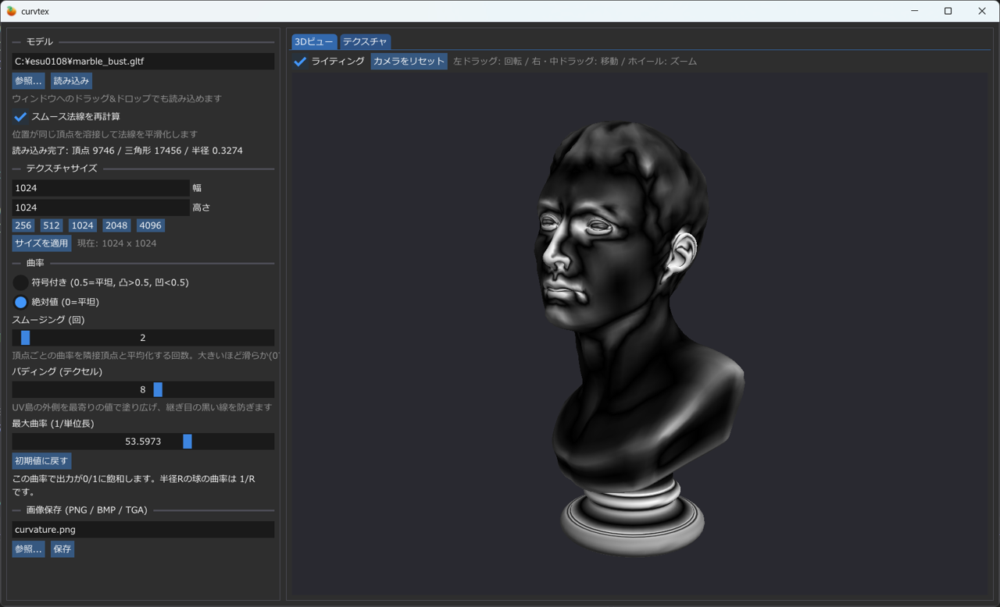

[English](README.md) | [日本語](README.ja.md)

# curvtex

**curvtex** は、3DモデルのUV座標を使用して、メッシュの曲率をテクスチャにベイクするGPUアクセラレーション対応ツールです。



## 主な機能

- DirectX 12によるGPU曲率計算
- 符号付き曲率・絶対値曲率の切り替え
- 曲率のスムージング
- UVアイランド周辺のパディング処理
- 3Dモデルとテクスチャのリアルタイムプレビュー
- PNG / BMP / TGA形式での保存（24bit）

## 対応フォーマット

| フォーマット | 拡張子 |
|---|---|
| Wavefront OBJ | `.obj` |
| glTF | `.gltf`, `.glb` |
| Autodesk FBX | `.fbx` |

## ビルド

**必要環境**
- Windows
- Visual Studio 2022以降
- CMake
- Windows SDK（`fxc.exe` を含む）

CMakeでビルドします。

```bash
cmake -S . -B build -G "Visual Studio 17 2022" -A x64
cmake --build build --config Release
```

実行：

```bash
build\Release\curvtex.exe
```

依存ライブラリはCMake FetchContentによって自動的に取得されます。

HLSLシェーダーはビルド時に `fxc.exe` で事前コンパイルされます。自動検出できない場合は `-DFXC_EXECUTABLE=<path>` でパスを指定してください。

## 使い方

1. **モデルの読み込み** — メニューの「ファイル → 開く」（`Ctrl+O`）でモデルを選ぶか、ウィンドウへドラッグ＆ドロップします。
2. **テクスチャサイズ** — テクスチャの幅と高さを設定します（16〜4096）。
3. **プレビュー** — 3Dモデルとベイク済みテクスチャの表示を切り替えます。
4. **曲率の調整** — 符号付き・絶対値の切り替え、スムージング、パディング、最大曲率を調整します。変更はリアルタイムに反映されます。
5. **画像の保存** — 「ファイル → 保存」（`Ctrl+S`）で保存先を選びます。PNG / BMP / TGA形式で、形式はファイルの拡張子によって決まります。
6. **表示メニュー** — 「表示 → 言語 / Language」でUIの言語を切り替えます（日本語・English・简体中文・한국어・Español・Français・Deutsch・Русский）。初回起動時はOSの表示言語に合わせ、対応外の言語なら英語になります。
   「表示 → アンチエイリアス」（MSAA）と「表示 → 異方性フィルタ」で3Dビューの描画品質を調整できます。

### 3Dビュー操作

| 操作 | 動作 |
|---|---|
| 左ドラッグ | 回転 |
| 右 / 中ドラッグ | 移動 |
| マウスホイール | ズーム |

## 制限事項

- モデルにはUV座標が必要です。
- UV座標が `[0, 1]` の範囲外にある部分は描画されません。
- Dracoおよびmeshopt圧縮されたglTFには対応していません。
- glTFは `TEXCOORD_0`、FBXは最初のUVセットを使用します。
- スキニングとモーフターゲットは評価されず、バインドポーズで処理されます。
- glTFとFBXはノード変換を適用したうえで、単一のメッシュに結合されます。
- 曲率の値は入力モデルの座標単位に依存します。FBXの単位変換は行いません。

## 依存ライブラリ

- [Dear ImGui](https://github.com/ocornut/imgui)
- [rapidobj](https://github.com/guybrush77/rapidobj)
- [fastgltf](https://github.com/spnda/fastgltf)
- [ufbx](https://github.com/ufbx/ufbx)