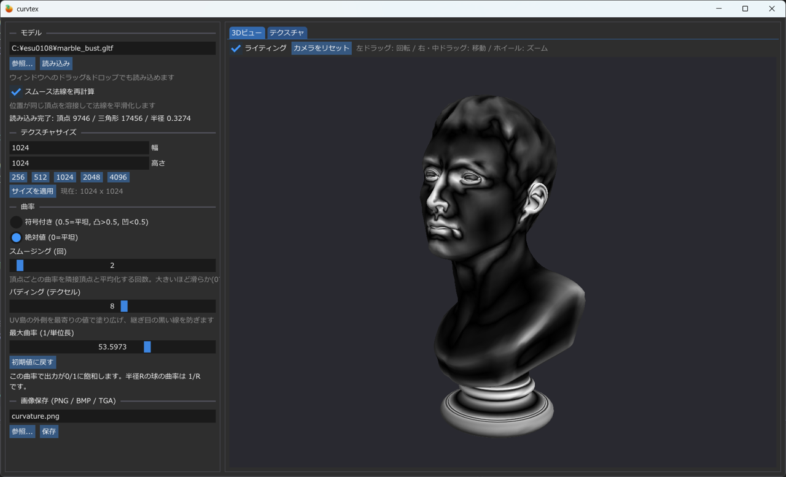

# curvtex

.obj / .gltf / .glb / .fbx のUV座標を使って、曲率をテクスチャにベイクし、PNG / BMP / TGA で保存するツールです。



## ビルド（Windows / Visual Studio 2022 推奨）

```
cmake -S . -B build -G "Visual Studio 17 2022" -A x64
cmake --build build --config Release
build\Release\curvtex.exe
```

初回の configure 時に FetchContent で次を取得します。

- Dear ImGui v1.93.0
- rapidobj v1.1（ヘッダオンリー）
- fastgltf v1.0.1（.gltf / .glb。simdjson / simdutf も自動取得）
- ufbx v0.23.1（.fbx。単一ソース）

## シェーダ

HLSL は `shaders/*.hlsl` にあり、ビルド時に `fxc`（Windows SDK）で事前コンパイルされ、
バイトコードが実行ファイルに埋め込まれます（実行時コンパイルはしません）。
`fxc.exe` が自動検出できない場合は `-DFXC_EXECUTABLE=<path>` を指定してください。

## 使い方

1. 「モデル」: パスを入力するか「参照...」で .obj / .gltf / .glb / .fbx を選び「読み込み」。ウィンドウへのファイルのドラッグ&ドロップでも読み込めます（複数ドロップ時は先頭の1つ）
2. 「テクスチャサイズ」: 幅/高さ（16〜4096）を入力し「サイズを適用」
3. 右側のタブで表示を切り替えます。
   - 「3Dビュー」: 曲率テクスチャを貼ったモデルを表示します。左ドラッグで回転、右/中ドラッグで移動、ホイールでズーム。「ライティング」で陰影の有無、「カメラをリセット」で初期位置に戻せます。
   - 「テクスチャ」: ベイクしたテクスチャそのものを表示します。
4. 「曲率」: 符号付き/絶対値の切り替え、スムージング回数、パディング幅、最大曲率で調整します（変更は即時反映）。モードと最大曲率はシェーディングだけ、スムージングは平滑化以降、パディングはパディング以降を再計算するので、ドラッグ中も軽く動きます。
5. 「画像保存」: パスを入力するか「参照...」で指定し「保存」。拡張子で形式が決まります（.png / .bmp / .tga、いずれも24bit。拡張子なしは .png）。PNGは Windows 標準の WIC で書き出します。

## 注意点

- UVが [0,1] の範囲外（タイリング）の部分は描画されません。
- 曲率は頂点ごとに GPU で計算します。隣接頂点との「(法線の差)・(位置の差) / |位置の差|²」を平均した値で、半径 R の球ではどこでも 1/R になります（凸で正、凹で負）。UV の継ぎ目などで分割された頂点は、位置が同じものを1つにまとめて計算するので、継ぎ目をまたいでも値が連続します。
- 頂点ごとの曲率は三角形の内側で補間されてテクスチャに書かれます。メッシュが粗いと三角形ごとの変化が見えるので、「スムージング」で隣接頂点との平均化を繰り返してください。
- 「パディング」でUV島の外側を最寄りのテクセルの値で塗り広げます（既定4テクセル、0で無効）。保存する画像にも反映されます。最寄りのテクセルの探索はジャンプフラッディング（GPU）で行うため、幅を大きくしても負荷はほとんど増えません（パス数は幅の対数に比例）。
- 法線が無い .obj は、位置ごとのスムース法線を自動生成します。
- UVが無いモデルは読み込めません（glTFは TEXCOORD_0、FBXは最初のUVセットを使用）。
- glTF / FBX はシーン内の全メッシュにノード変換を適用して1つに結合します。
  UV が無いプリミティブは読み飛ばし、スキニング/モーフはバインドポーズのまま扱います。
- glTF の UV は v が下向きのため、本ツールの v 上向きに合わせて `v = 1 - v` へ変換します（OBJ / FBX はそのまま）。
- 圧縮メッシュ（Draco / meshopt）のglTFは未対応です。
- 曲率の単位はファイルの座標単位に依存します（FBXの単位変換は行いません）。